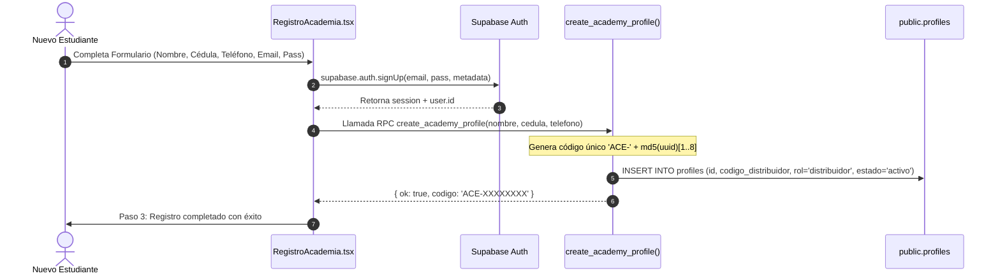
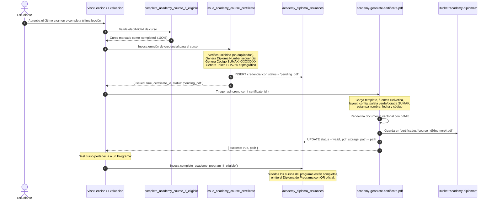

# 🌿 Ecosistema Educativo SUMAK: Dossier de Arquitectura, Producto y Academia
## Programa Especializado: "Salud Integral y Cuidado Renal con Productos SUMAK"
**Documento Técnico-Comercial Maestro**  
**Fecha:** Septiembre 2026 | **Versión:** 1.0.0  
**Autor:** Arquitecto Principal de Producto & Experto Comercial SUMAK

---

## Índice General

1. [Área 1: Contexto Comercial y Médico (Línea de Productos SUMAK)](#1-contexto-comercial-y-médico-línea-de-productos-sumak)
   - [1.1 Filosofía de Salud SUMAK y el Cuidado Renal](#11-filosofía-de-salud-sumak-y-el-cuidado-renal)
   - [1.2 Fisiología Andina y el Eje Intestino-Hígado-Riñón](#12-fisiología-andina-y-el-eje-intestino-hígado-riñón)
   - [1.3 Vademécum de Productos Clave con Tropismo Renal](#13-vademécum-de-productos-clave-con-tropismo-renal)
   - [1.4 Protocolo Clínico-Comercial de Recomendación en 3 Fases](#14-protocolo-clínico-comercial-de-recomendación-en-3-fases)
   - [1.5 Arquetipos y Perfiles de Estudiantes del Programa](#15-arquetipos-y-perfiles-de-estudiantes-del-programa)
2. [Área 2: Arquitectura General del Ecosistema SUMAK](#2-arquitectura-general-del-ecosistema-sumak)
   - [2.1 Topología de Roles y Permisos](#21-topología-de-roles-y-permisos)
   - [2.2 Proceso de Registro y Onboarding del Estudiante](#22-proceso-de-registro-y-onboarding-del-estudiante)
   - [2.3 Enrutamiento Inteligente por Rol (`homeForProfile`)](#23-enrutamiento-inteligente-por-rol-homeforprofile)
3. [Área 3: Motor Técnico de la Academia SUMAK](#3-motor-técnico-de-la-academia-sumak)
   - [3.1 Jerarquía Estricta de Datos y Modelos](#31-jerarquía-estricta-de-datos-y-modelos)
   - [3.2 Tipologías de Lecciones, Proveedores y Obligatoriedad (`is_required`)](#32-tipologías-de-lecciones-proveedores-y-obligatoriedad-is_required)
   - [3.3 Sistema de Evaluaciones, Tipos de Preguntas y Motor de Calificación](#33-sistema-de-evaluaciones-tipos-de-preguntas-y-motor-de-calificación)
   - [3.4 Motor de Seguimiento (Tracking) y Algoritmo de Elegibilidad](#34-motor-de-seguimiento-tracking-y-algoritmo-de-elegibilidad)
   - [3.5 Flujo Completo de Certificación y Generación de PDF/QR](#35-flujo-completo-de-certificación-y-generación-de-pdfqr)
4. [Estructura Propuesta para el Programa de 2 Cursos](#4-estructura-propuesta-para-el-programa-de-2-cursos)

---

# 1. Contexto Comercial y Médico (Línea de Productos SUMAK)

## 1.1 Filosofía de Salud SUMAK y el Cuidado Renal

**SUMAK VIDA ECUADOR S.A.** fundamenta su propuesta de valor en la unión de la **sabiduría ancestral andino-amazónica** y los estándares de la biotecnología fitoterapéutica moderna a través de su laboratorio especializado **Sumak Jambi**, bajo el liderazgo del **Dr. Luis Paredes** (Gerente General y Formador de Formadores).

El lema rector de la marca —**"Limpia · Desintoxica · Regenera"**— dicta que ninguna patología crónica es un accidente aislado, sino la consecuencia del desequilibrio biológico originado por la saturación de los órganos emuntorios (colon, hígado, riñones y piel).

### El Enfoque Renal en SUMAK
En la cosmovisión médica de SUMAK, los riñones no son simples coladores pasivos; son los **órganos reguladores del Qi vital, el balance hidrosalino, la presión osmótica y la depuración de la sangre**.
* **El problema moderno:** La dieta alta en sodio procesado, azúcares refinados, carnes rojas y agua baja en electrolitos produce hipercalciuria, hiperuricosuria (ácido úrico) y precipitación de oxalato de calcio, microlesionando los glomérulos y túbulos renales.
* **La respuesta SUMAK:** En lugar de forzar al riñón con diuréticos sintéticos que agotan el potasio o lesionan el túbulo contorneado distal, SUMAK aplica fitonutrientes botánicos que:
  1. Alcalinizan la orina y modifican la tensión superficial para disgregar cristales de cálculo (*acción litolítica y desarenadora*).
  2. Aumentan la filtración glomerular suave sin descompensación electrolítica (*diuresis acuosa ahorradora de potasio*).
  3. Protegen la pared urotelial contra bacterias uropatógenas (*antiadherencia de E. coli*).
  4. Reducen el estrés oxidativo tisular y la microinflamación tubular.

---

## 1.2 Fisiología Andina y el Eje Intestino-Hígado-Riñón

Un principio médico innegociable en los protocolos SUMAK es el **Eje Intestino-Riñón (Gut-Kidney Axis)**:
1. Cuando el colon está impactado de materia fecal antigua, parásitos y amebas, se genera disbiosis y permeabilidad de la mucosa intestinal.
2. Las bacterias colónicas degradan aminoácidos aromáticos produciendo toxinas urémicas como el **indoxil sulfato** y el **p-cresil sulfato**.
3. Estas toxinas atraviesan la barrera intestinal, sobrecargan el hígado y terminan acumulándose en la circulación sistémica.
4. El riñón se ve obligado a filtrar estas moléculas tóxicas de alto peso molecular, lo que causa esclerosis glomerular, inflamación intersticial y pérdida progresiva de la tasa de filtración.

> [!IMPORTANT]
> Todo tratamiento o curso formativo sobre salud renal en SUMAK **debe enseñar que no se puede drenar el riñón sin antes descongestionar el colon y purificar la linfa**. De lo contrario, se movilizan toxinas hacia un filtro ya colapsado.

---

## 1.3 Vademécum de Productos Clave con Tropismo Renal

A partir del análisis del catálogo central de productos (`src/data.ts`), se identifican las formulaciones con acción terapéutica directa o coadyuvante sobre el aparato nefrourinario:

### 1. Madre Silvestre (Cápsulas) — [Cód. 00011]
*La fórmula maestra botánica para el tracto urinario y desbalance renal/pélvico.*
* **Presentación:** Frasco de 100 cápsulas de 500 mg c/u.
* **PVP:** $20.00 | **Precio Distribuidor:** $10.00.
* **Ingredientes Clave y Mecanismo Nefrítico:**
  - **Chancapiedra (*Phyllanthus niruri*):** Reconocida científicamente como la planta litolítica por excelencia. Inhibe la agregación de cristales de oxalato de calcio, relaja el músculo liso ureteral facilitando la expulsión de litos y arenillas sin dolor cólico.
  - **Flor de Arenilla:** Planta andina tradicional con alto tropismo renal; estimula la excreción de sales precipitadas y sedimentos urinarios.
  - **Cola de Caballo (*Equisetum arvense*):** Rica en sílice orgánico, potasio y flavonoides. Actúa como diurético suave remineralizante; aumenta el volumen urinario sin provocar hipopotasemia.
  - **Canchalagua (*Schkuhria pinnata*):** Potente depurativo andino de sangre y linfa; reduce la sobrecarga metabólica hepatorrenal.
  - **Uña de Gato (*Uncaria tomentosa*):** Inmunomodulador y antiinflamatorio sistémico; frena la cascada de citoquinas en nefritis y cistitis.
  - **Malva y Sábila:** Mucílagos demulcentes que recubren y suavizan el urotelio irritado.
  - **Sangre de Drago (*Croton lechleri*):** Taspina y proantocianidinas con efecto cicatrizante tisular microlesional.
  - **Minerales y Vitaminas:** Potasio, Calcio, Hierro, Magnesio, Zinc, Ácido Fólico, Selenio, B6, C y E.
* **Beneficios Renales:** Expulsión indolora de arenilla renal, desinflamación de riñones y vías urinarias, prevención de recurrencia de cálculos, alivio de sensación de pesadez lumbar.
* **Contraindicaciones:** Embarazo, lactancia, pacientes con insuficiencia renal estadio 5 o anuria no dializada.
* **Modo de Uso:** 1 cápsula 2 veces al día antes de las comidas principales, con abundante agua tibia.

---

### 2. Té Extractos de la Vida (Bebida) — [Cód. 00001]
*El protector endotelial y desintoxicante sistémico celular.*
* **Presentación:** Botella de 1000 ml.
* **PVP:** $25.00 | **Precio Distribuidor:** $12.50.
* **Ingredientes Clave y Mecanismo Nefrítico:**
  - **Extracto de Arándano Azul (*Blueberry/Cranberry*):** Concentrado en Proantocianidinas Tipo A (PACs). Impide que las fimbrias de *Escherichia coli* y otros uropatógenos se adhieran a las paredes de la vejiga y uréteres.
  - **Extracto de Diente de León (*Taraxacum officinale*):** Estimula la función depurativa biliar y renal (diuresis osmótica suave rica en potasio).
  - **Resveratrol de Uva:** Antioxidante celular que frena la fibrosis renal y protege el endotelio de los capilares glomerulares.
  - **Pectina de Manzana Verde, Guanábana, Noni, Moringa, Aloe Vera:** Quelación natural de metabolitos y modulación inmunológica.
* **Beneficios Renales:** Prevención de Infecciones del Tracto Urinario (ITU) recurrentes, neutralización de radicales libres en la nefrona, reducción del edema por retención de líquidos.
* **Modo de Uso:** 30 ml (2 cucharadas soperas) diluidos en un vaso con agua (250 ml), 1 a 2 veces al día. Refrigerar tras abrir.

---

### 3. Bebida Andina — [Cód. 00003]
*Regulador de la microcirculación y reductor del ácido úrico.*
* **Presentación:** Botella de 1000 ml.
* **PVP:** $20.00 | **Precio Distribuidor:** $10.00.
* **Ingredientes Clave y Mecanismo Nefrítico:**
  - **Extracto de Flor de Jamaica (*Hibiscus sabdariffa*):** Inhibe la enzima convertidora de angiotensina (ECA), regulando la presión intraglomerular; ejerce un efecto uricosúrico comprobado expulsando ácido úrico por la orina.
  - **Extracto de Maíz Morado:** Altísima concentración de antocianinas protectoras de la microvasculatura renal.
  - **Cardamomo, Jengibre, Moringa, Diente de León, Uña de Gato, Nogal.**
* **Beneficios Renales:** Manejo coadyuvante de la hipertensión secundaria a sobrecarga de volumen, reducción de hiperuricemia (gota y nefropatía por uratos), potente efecto antioxidante.
* **Modo de Uso:** 30 ml diluidos en un vaso con agua, 1 a 2 veces al día.

---

### 4. Vive-Oxi-100 (Concentrado Líquido) — [Cód. 00004]
*Oxigenación y bioenergética celular para tejidos hipóxicos.*
* **Presentación:** Frasco gotero de 50 ml concentrado.
* **PVP:** $25.00 | **Precio Distribuidor:** $12.50.
* **Ingredientes Clave:** Oxígeno líquido biodisponible, Esencias de Totumo, Borrajas, Jengibre, Ajo, Toronjil, Menta, Miel de Abeja, Cloruro de Magnesio y Complejo B.
* **Beneficios Renales:** La médula renal opera normalmente en un estado fisiológico de relativa hipoxia; Vive-Oxi-100 apoya la oxigenación celular, previene la isquemia tubular y optimiza el intercambio de fluidos a nivel de membrana.
* **Modo de Uso:** 20 a 30 gotas diluidas en medio vaso de agua pura, 2 veces al día.

---

### 5. Fibramak Plus [Cód. 00005] y Colón Renova [Cód. 00016] (Soporte del Eje Digestivo)
* **Ingredientes:** Probióticos vegetales, Hoja de Sen dosificada, Semilla de Papaya, Chía, Cúrcuma, Linaza, Sábila, Alfalfa y Piña (Bromelina).
* **Rol en el Protocolo Renal:** Desbloqueo del colon para frenar la producción de toxinas urémicas indólicas. Se toma al inicio del protocolo para garantizar que la sangre que llega al riñón contenga menor carga tóxica.

---

## 1.4 Protocolo Clínico-Comercial de Recomendación en 3 Fases

Este esquema es el que se transformará en el núcleo didáctico de los 2 cursos:

```mermaid
flowchart LR
    subgraph FASE1["Fase 1: Desintoxicación Sistémica (Días 1 a 10)"]
        F1A["Colon Renova o Fibramak Plus"]
        F1B["Té Extractos de la Vida"]
        F1C["Objetivo: Limpiar colon y descongestionar linfa"]
    end
    
    subgraph FASE2["Fase 2: Litolisis y Drenaje Renal (Días 11 a 35)"]
        F2A["Madre Silvestre (2 cápsulas/día)"]
        F2B["Bebida Andina (Jamaica + Maíz Morado)"]
        F2C["Objetivo: Disolver arenillas, desinflamar nefronas"]
    end
    
    subgraph FASE3["Fase 3: Oxigenación y Regeneración (Días 36 a 60)"]
        F3A["Vive-Oxi-100 (Gotas)"]
        F3B["Té Extractos de la Vida (Mantenimiento)"]
        F3C["Objetivo: Restaurar energía celular y microcirculación"]
    end

    FASE1 --> FASE2 --> FASE3
```



---

## 1.5 Arquetipos y Perfiles de Estudiantes del Programa

El programa no es exclusivo de un solo tipo de usuario. En el ecosistema SUMAK conviven tres audiencias con intereses distintos:

| Perfil | Nivel Técnico Requerido | Motivación Principal | Enfoque Pedagógico |
|---|---|---|---|
| **1. Distribuidor / Líder de Red SUMAK** | Intermedio | Vender con autoridad ética, armar combos recomendados, duplicar conocimiento en su red binaria/unilevel. | Objeciones de clientes, combinaciones de productos, casos de éxito, marco regulatorio (suplemento vs medicina). |
| **2. Terapeuta / Naturópata / Profesional Integrativo** | Avanzado | Evidencia científica de plantas andinas (chancapiedra, jamaica, cola de caballo), interacciones, bioactivos. | Mecanismos de acción, fitofarmacología, dosificación clínica, fisiopatología del glomérulo y túbulos. |
| **3. Paciente / Estudiante de Academia Gratuita (`ACE-`)** | Básico / Preventivo | Mejorar su propia salud, expulsar arenillas, prevenir diálisis en familiares, aprender hábitos y nutrición. | Lenguaje claro, recetas caseras, hidratación correcta, señales de alarma médica, uso seguro del producto. |

---

# 2. Arquitectura General del Ecosistema SUMAK

## 2.1 Topología de Roles y Permisos

SUMAK utiliza una arquitectura desacoplada en Supabase donde coexisten **roles de negocio MLM** y **roles pedagógicos de Academia**:

```
                       ┌────────────────────────┐
                       │       auth.users       │ (Identidad Supabase)
                       └───────────┬────────────┘
                                   │
         ┌─────────────────────────┴─────────────────────────┐
         ▼                                                   ▼
┌─────────────────────────────────┐         ┌─────────────────────────────────┐
│         public.profiles         │         │      public.academy_roles       │
│  (Negocio MLM / Base General)   │         │    (Roles Específicos LMS)      │
├─────────────────────────────────┤         ├─────────────────────────────────┤
│ rol: 'admin'                    │         │ role: 'academy_admin'           │
│ rol: 'operaciones'              │         │ role: 'instructor'              │
│ rol: 'distribuidor'             │         │ role: 'student'                 │
│ codigo_distribuidor: text       │         │ (Permite staff sin privilegios  │
│   • 'SMK-XXXX' -> Distribuidor  │         │  totales sobre el core MLM)     │
│   • 'ACE-XXXX' -> Estudiante    │         └─────────────────────────────────┘
└─────────────────────────────────┘
```

### Funciones Helper de Seguridad en Postgres (RLS):
* `public.is_admin()`: Comprueba si `profiles.rol = 'admin'`.
* `public.is_academy_admin()`: Comprueba si es admin global o posee rol `academy_admin` en `academy_roles`.
* `public.is_academy_instructor()`: Comprueba si posee rol `instructor` activo en `academy_roles`.
* `public.is_academy_staff()`: `is_academy_admin() OR is_academy_instructor()`.
* `public.has_course_access(course_id)`: Valida la modalidad del curso (`public`, `free_registered`, `sumak_exclusive`, `premium`, `assigned`) contra la sesión del estudiante.

---

## 2.2 Proceso de Registro y Onboarding del Estudiante

El sistema cuenta con un circuito de registro independiente para la Academia que elimina las barreras del multinivel tradicional (no exige patrocinador ni compra forzada de paquete):



### El Tour de Bienvenida (Onboarding)
* La tabla `profiles` cuenta con la columna `has_completed_onboarding boolean`.
* Al ingresar por primera vez, el sistema dispara el tour introductorio guiando al estudiante hacia el catálogo y su dashboard.
* El estado se sincroniza en base de datos y en `localStorage` (`sumak_onboarding_completed_${uid}`).

---

## 2.3 Enrutamiento Inteligente por Rol (`homeForProfile`)

Definido en [`src/lib/auth.tsx`](file:///c:/Users/Robin/Desktop/RSD%20Solutions/Sumak/src/lib/auth.tsx#L158-L172):

```typescript
function homeForProfile(p: Profile | null) {
  if (!p) return '/login';
  if (p.rol === 'admin') return '/admin';
  if (p.rol === 'operaciones') return '/operaciones';
  if (p.rol === 'distribuidor') {
    // Si su código inicia con 'ACE-', es un estudiante de Academia gratuita
    const isAcademyFree = p.codigo_distribuidor?.startsWith('ACE-') ?? false;
    if (isAcademyFree) {
      return '/academia/dashboard';
    }
    // Distribuidor comercial con acceso a red y oficina virtual
    return '/dashboard';
  }
  return '/login';
}
```

---

# 3. Motor Técnico de la Academia SUMAK

## 3.1 Jerarquía Estricta de Datos y Modelos

El motor educativo de SUMAK sigue una estructura jerárquica de 4 capas:

```
[ PROGRAMA: academy_programs ]
       │
       ├──> [ academy_program_courses ] (Orden, is_required, Prerrequisitos)
       │           │
       │           ▼
       └──> [ CURSO: academy_courses ]
                   │
                   └──> [ MÓDULO: academy_modules ]
                               │
                               └──> [ LECCIÓN: academy_lessons ]
                                           ├── [ RECURSOS: academy_resources ]
                                           └── [ EVALUACIÓN: academy_assessments ]
```

### Tabla Resumen de Metadatos Requeridos por Entidad:

| Nivel | Tabla BD | Campos Obligatorios Clave | Metadatos y Configuración |
|---|---|---|---|
| **1. Programa** | `academy_programs` | `title`, `slug`, `status` (`draft`, `published`, `archived`), `access_mode` (`public`, `free_registered`, etc.), `completion_percentage_required` (default 100). | `diploma_type_id` (FK a tipo de diploma del programa), `final_exam_assessment_id` (examen integrador opcional). |
| **Intermedia** | `academy_program_courses` | `program_id`, `course_id`, `sort_order`, `is_required`. | Prerrequisitos en `academy_program_course_prereqs` (el Curso B requiere haber aprobado el Curso A). |
| **2. Curso** | `academy_courses` | `title`, `slug`, `status`, `access_mode`, `level` (`beginner`, `intermediate`, `advanced`, `all`), `passing_percentage` (default 70%). | `cover_image_url`, `estimated_duration_minutes`, `generates_certificate` (true/false), `instructor_id`. |
| **3. Módulo** | `academy_modules` | `course_id`, `title`, `sort_order`, `is_published`. | Agrupador temático o unidad pedagógica dentro del curso. |
| **4. Lección** | `academy_lessons` | `module_id`, `title`, `content_type`, `sort_order`, `is_published`, `is_required` (default true). | `video_provider`, `video_external_id`, `text_content`, `file_url`, `is_free_preview`, `estimated_minutes`. |

---

## 3.2 Tipologías de Lecciones, Proveedores y Obligatoriedad (`is_required`)

### A. Tipos de Contenido Soportados (`content_type`):
1. `'video'`: Video como eje central. El reproductor desacoplado soporta:
   - `youtube`: Se almacena únicamente el ID del video (ej. `dQw4w9WgXcQ`).
   - `vimeo`, `cloudflare`, `mux`, `bunny`, `custom`: Soporte multi-proveedor.
2. `'text'`: Texto enriquecido y formateado en Markdown nativo.
3. `'pdf'`: Documentos de lectura embebidos directamente en el visor.
4. `'mixed'`: Combina video superior y cuerpo de texto explicativo inferior.
5. `'external_link'`: Enlaces a webinars, transmisiones en vivo o herramientas externas.
6. `'assessment'`: Lección de tipo prueba/examen interactivo.

### B. Recursos Descargables (`academy_resources`):
* Cada lección puede tener múltiples archivos adjuntos.
* Alojamiento: Se suben al bucket privado de Supabase Storage `academy-resources` o se vinculan mediante URLs externas públicas (Google Drive, Dropbox).
* Metadata: `title`, `file_url`, `file_type` (`pdf`, `xlsx`, `docx`), `file_size_bytes`.

### C. La Bandera `is_required` (Obligatoriedad):
Añadida en la migración `20260904110000`:
* **Si `is_required = true` (por defecto):** El motor de elegibilidad (`complete_academy_course_if_eligible`) exige que exista un registro en `academy_progress` con `status = 'completed'` para esta lección. Sin ella, el curso **nunca alcanzará el 100% ni emitirá certificado**.
* **Si `is_required = false`:** La lección se clasifica como *material optativo o lectura complementaria*. El estudiante puede avanzar y graduarse sin marcarla como completada.

---

## 3.3 Sistema de Evaluaciones, Tipos de Preguntas y Motor de Calificación

El sistema de exámenes de SUMAK está blindado contra fraude y manipulación en el cliente:

```
[ academy_assessments ] ──> [ academy_questions ] ──> [ academy_question_options ]
         │                            │                               │
         │                            │ (points, explanation)         │ (is_correct oculto para alumnos)
         ▼                            ▼                               ▼
[ academy_attempts ] ────> [ academy_answers ] ──> Calificado por Edge Function server-side
```

### Características Técnicas del Módulo de Evaluación:
1. **Tipos de Pregunta (`question_type`):**
   - `single_choice`: Opción única con radio buttons. Solo una opción tiene `is_correct = true`.
   - `multiple_choice`: Selección múltiple con checkboxes. Requiere que el alumno seleccione el **conjunto exacto** de opciones correctas para obtener el puntaje completo.
   - `true_false`: Pregunta dicotómica de dos alternativas.
2. **Seguridad y Ocultamiento de Respuestas:**
   - La columna `is_correct` en `academy_question_options` se expone al estudiante mediante la vista sanitizada `academy_question_options_public`, impidiendo la inspección del DOM o Network tab.
3. **Calificación Servidor (Edge Function `academy-grade-assessment`):**
   - El estudiante envía sus respuestas (`academy_answers`).
   - La Edge Function lee las preguntas con Service Role, computa los puntos ganados contra el puntaje máximo, calcula el porcentaje y actualiza `academy_attempts`:
     $$\text{percentage} = \left(\frac{\text{total\_score}}{\text{max\_score}}\right) \times 100$$
   - Se marca `passed = true` si $\text{percentage} \ge \text{passing\_score}$.
4. **Control de Intentos y Tiempos:**
   - `max_attempts`: Si se define un entero (ej. 3 intentos), el RPC bloquea la creación de nuevos intentos si el alumno agotó el límite.
   - `time_limit_minutes`: Dispara un temporizador con cuenta regresiva en el frontend; al llegar a 00:00 se auto-envía la evaluación.
5. **Retroalimentación Pedagógica:**
   - Campo `explanation` en `academy_questions`: Muestra al alumno la justificación médica/comercial tras enviar el intento.

---

## 3.4 Motor de Seguimiento (Tracking) y Algoritmo de Elegibilidad

### Estados y Métricas de Progreso:
* `academy_enrollments`:
  - `status`: `'active'`, `'completed'`, `'dropped'`, `'suspended'`.
  - `progress_percentage`: Calculado como $\frac{\text{Lecciones Obligatorias Completadas}}{\text{Total Lecciones Obligatorias}} \times 100$.
* `academy_progress` (por lección):
  - `status`: `'not_started'`, `'in_progress'`, `'completed'`.
  - `playback_seconds`: Almacena el segundo de reproducción alcanzado en lecciones de video.

### El Algoritmo del Motor de Completitud (`complete_academy_course_if_eligible`):
Esta función almacenada en Postgres evalúa 4 condiciones estrictas antes de declarar un curso como completado:

```sql
-- 1. Cuenta lecciones publicadas que sean obligatorias
select count(*) into v_total_lessons
from public.academy_lessons l
join public.academy_modules m on m.id = l.module_id
where m.course_id = p_course_id and m.is_published and l.is_published and l.is_required = true;

-- 2. Cuenta lecciones obligatorias completadas por el alumno
select count(*) into v_completed_lessons
from public.academy_progress p
join public.academy_lessons l on l.id = p.lesson_id
join public.academy_modules m on m.id = l.module_id
where p.user_id = p_user_id and p.course_id = p_course_id
  and m.course_id = p_course_id and m.is_published and l.is_published and l.is_required = true 
  and p.status = 'completed';

-- 3. Cuenta evaluaciones publicadas del curso
select count(*) into v_total_assessments
from public.academy_assessments
where course_id = p_course_id and is_published;

-- 4. Cuenta evaluaciones con al menos un intento aprobado ('passed = true')
select count(distinct a.assessment_id) into v_passed_assessments
from public.academy_attempts a
where a.user_id = p_user_id and a.passed = true and a.status = 'graded'
  and exists (select 1 from public.academy_assessments x where x.id = a.assessment_id and x.course_id = p_course_id and x.is_published);

-- REGLA DE CORTE:
if v_total_lessons = 0 or v_completed_lessons < v_total_lessons or v_passed_assessments < v_total_assessments then
  return jsonb_build_object('completed', false);
end if;

-- Si aprueba:
update public.academy_enrollments
set status = 'completed', progress_percentage = 100, completed_at = now()
where id = v_enrollment.id;
```

---

## 3.5 Flujo Completo de Certificación y Generación de PDF/QR

Tras la auditoría y refactorización integral del **20 de septiembre de 2026** (`20260920000001_certificate_system_integral_fix.sql`), el sistema unificó todas las credenciales en la tabla `academy_diploma_issuances`.

### Diferenciación de Credenciales:
1. **Certificado de Curso Individual (`credential_type = 'certificate'`):**
   - Emitido automáticamente al aprobar un curso específico.
   - Vinculado al `course_id`.
   - Utiliza la plantilla de tipo `'CERT_CURSO'`.
2. **Diploma de Programa Superior (`credential_type = 'diploma'`):**
   - Emitido al completar el 100% de los cursos requeridos del programa.
   - Vinculado al `program_id`.
   - Utiliza la plantilla oficial asociada al programa en `academy_diploma_types`.

### Diagrama de Secuencia del Flujo de Emisión:



### Verificación Pública del Documento:
* Cualquier tercero o empleador puede escanear el código QR impreso en el PDF o ingresar a:
  `https://www.sumakecuador.lat/academia/verificar?token=SUMAK-XXXXXXXX`
* La función pública `verify_diploma_public(p_token)` consulta la base de datos sin requerir inicio de sesión y devuelve:
  - Nombre completo del estudiante
  - Nombre del curso o programa aprobado
  - Fecha de emisión
  - Entidad emisora: *"SUMAK Vida Ecuador S.A."*
  - Estado: `VALID` (o `REVOKED` si fue anulado por auditoría).

---

# 4. Estructura Propuesta para el Programa de 2 Cursos

Con base en toda la arquitectura expuesta, el programa formativo de Cuidado Renal se diseñará bajo la siguiente configuración recomendada:

```
PROGRAMA: "Especialización en Salud Renal y Terapia Botánica Andina"
├── Slug: 'especializacion-salud-renal-sumak'
├── Acceso: 'free_registered' o 'sumak_exclusive'
├── Requerimiento: 100% de cursos obligatorios
└── Diploma: Diploma de Honor en Salud Renal Andina (con PDF + QR)

    ├── CURSO 1 (Básico / Fundacional):
    │   ├── Título: "Bases Fisiológicas y Prevención Renal: El Enfoque Ancestral SUMAK"
    │   ├── Nivel: 'beginner' | Passing: 70%
    │   ├── Enfoque: El filtro de la vida, Eje Intestino-Riñón, Hidratación y Té Extractos de la Vida.
    │   └── Salida: Certificado de Curso 1.
    │
    └── CURSO 2 (Avanzado / Terapéutico) [Requiere Curso 1]:
        ├── Título: "Fitoterapia Avanzada y Protocolos Renales con Chancapiedra y Plantas Andinas"
        ├── Nivel: 'advanced' | Passing: 75%
        ├── Enfoque: Mecanismo de Madre Silvestre, litiasis, ácido úrico, Bebida Andina y dosificación.
        └── Salida: Certificado de Curso 2 + Diploma Superior del Programa.
```

---
*Fin del Dossier de Arquitectura. Documento generado para la Academia SUMAK.*
