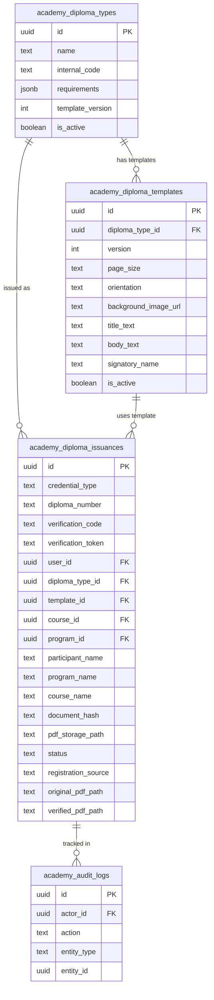

# 🔍 Auditoría Completa: Sistema de Certificados y Diplomas — Academia SUMAK

## Resumen Ejecutivo

El sistema de credenciales de la Academia SUMAK ha evolucionado a través de **múltiples migraciones incrementales** que han generado una arquitectura fragmentada con **código duplicado, estados inconsistentes y bugs activos**. Esta auditoría documenta el estado actual, identifica cada problema, y propone un plan de corrección.

---

## 1. Arquitectura Actual

### 1.1 Tipos de Credenciales

El sistema maneja **2 tipos de credenciales** almacenados en la misma tabla `academy_diploma_issuances`:

| Tipo | `credential_type` | Flujo de Emisión | PDF | Verificación |
|---|---|---|---|---|
| **Certificado de curso** | `'certificate'` | Automático (RPC `issue_academy_course_certificate`) | ❌ No genera PDF | ❌ Sin verificación pública |
| **Diploma de programa** | `'diploma'` | Manual (Edge Function `academy-issue-diploma`) o automático (completar programa) | ✅ Genera PDF con pdf-lib | ✅ Token + código de verificación |
| **Diploma registrado (QR)** | `'diploma'` | Manual admin (Edge Function `academy-register-existing-diploma`) | ✅ Se sube PDF + genera copia con QR | ✅ Token hash + verificación pública |

### 1.2 Tablas Involucradas

### 1.3 Edge Functions (7 funciones)

| Función | Propósito | Estado |
|---|---|---|
| [`academy-issue-diploma`](file:///c:/Users/Robin/Desktop/RSD%20Solutions/Sumak/supabase/functions/academy-issue-diploma/index.ts) | Emitir diploma manual (admin) con PDF generado | ⚠️ Funcional con bugs |
| [`academy-check-eligibility`](file:///c:/Users/Robin/Desktop/RSD%20Solutions/Sumak/supabase/functions/academy-check-eligibility/index.ts) | Verificar elegibilidad pre-emisión | ✅ Funcional |
| [`academy-verify-diploma`](file:///c:/Users/Robin/Desktop/RSD%20Solutions/Sumak/supabase/functions/academy-verify-diploma/index.ts) | Verificación pública de diploma (via RPC) | ⚠️ Parcial |
| [`academy-revoke-diploma`](file:///c:/Users/Robin/Desktop/RSD%20Solutions/Sumak/supabase/functions/academy-revoke-diploma/index.ts) | Revocar diploma (admin) | ✅ Funcional |
| [`academy-sign-document-url`](file:///c:/Users/Robin/Desktop/RSD%20Solutions/Sumak/supabase/functions/academy-sign-document-url/index.ts) | Generar URL firmada para descarga | ⚠️ Falla en certificados |
| [`academy-register-existing-diploma`](file:///c:/Users/Robin/Desktop/RSD%20Solutions/Sumak/supabase/functions/academy-register-existing-diploma/index.ts) | Registrar diploma existente + QR | ✅ Funcional |
| [`academy-generate-verified-diploma`](file:///c:/Users/Robin/Desktop/RSD%20Solutions/Sumak/supabase/functions/academy-generate-verified-diploma/index.ts) | Generar copia con QR de diploma registrado | ✅ Funcional |

### 1.4 RPC Functions (SQL)

| Función | Propósito | Estado |
|---|---|---|
| `issue_academy_course_certificate` | Emitir certificado de curso al completar | ⚠️ Conflictos con index |
| `verify_diploma_public` | Verificación pública sin auth | ⚠️ No encuentra certificados |
| `academy_next_diploma_number` | Genera número secuencial diploma | ✅ |
| `academy_next_certificate_number` | Genera número secuencial certificado | ✅ |
| `academy_next_credential_number` | Wrapper unificado cert/diploma | ✅ |
| `complete_academy_program_if_eligible` | Completar programa + emitir diploma | ⚠️ 3 versiones conflictivas |
| `get_my_academy_certificates` | Obtener certificados del usuario | ❌ Tabla renombrada |

---

## 2. 🐛 Bugs Críticos Encontrados y Estado de Resolución

### BUG-1: `get_my_academy_certificates()` consulta tabla inexistente
> **Estado:** ✅ **RESUELTO** (Migración `20261116000002_fix_academy_credentials_and_full_curriculum.sql`)  
> **Corrección:** Se recreó la función RPC `get_my_academy_certificates()` para consultar directamente `public.academy_diploma_issuances` filtrando por `user_id = auth.uid() AND credential_type = 'certificate'`, eliminando cualquier referencia a la antigua tabla renombrada `_backup_academy_certificates`. Ahora los certificados de curso se visualizan correctamente en el portal del estudiante.

---

### BUG-2: `issue_academy_course_certificate` inserta en `academy_diploma_issuances` con `diploma_type_id = NULL`
> **Estado:** ✅ **RESUELTO** (Migración `20261116000002_fix_academy_credentials_and_full_curriculum.sql`)  
> **Corrección:** Se insertó un registro canónico idempotente en `public.academy_diploma_types` con `internal_code = 'CERT_CURSO'` ("Certificado de Curso SUMAK") junto con su plantilla activa en `public.academy_diploma_templates`. La RPC `issue_academy_course_certificate` ahora asigna este `diploma_type_id` y `template_id` en lugar de `NULL`, genera tokens criptográficos (`verification_token`) y códigos cortos legibles (`verification_code`), e implementa control de duplicados estricto con el índice único `academy_credential_no_duplicate`.

---

### BUG-3: Certificados de curso se crean con `status = 'pending_pdf'` pero nunca se genera PDF
> **Estado:** ✅ **RESUELTO** (Migración `20261116000002` + Edge Function `academy-generate-certificate-pdf`)  
> **Corrección:** Se actualizó el `CHECK constraint` en `academy_diploma_issuances` para admitir formalmente `'pending_pdf'` (`check (status in ('issued', 'valid', 'revoked', 'superseded', 'invalidated', 'pending_pdf'))`). Además, se implementó y desplegó la Edge Function dedicada `academy-generate-certificate-pdf` que lee credenciales en `'pending_pdf'`, genera el PDF vectorial con `pdf-lib` incorporando código de verificación y QR público, lo guarda en Supabase Storage (`academy-diplomas`) y actualiza el estado a `'valid'`.

---

### BUG-4: `revokeDiploma()` en frontend usa `DELETE` en vez de `UPDATE`
> **Estado:** ✅ **RESUELTO** (`src/lib/academy.ts`)  
> **Corrección:** Se eliminó la llamada directa a `.delete()` en `academyAPI.revokeDiploma()`. El método ahora delega formalmente la revocación a la Edge Function `academy-revoke-diploma`, garantizando auditoría completa (`academy_audit_logs`), timestamp de revocación y transición de estado a `'revoked'`.

---

### BUG-5: Código completamente duplicado en `academy.ts`
> **Estado:** ✅ **RESUELTO** (`src/lib/academy.ts`)  
> **Corrección:** Se realizó una limpieza quirúrgica del archivo `src/lib/academy.ts`, eliminando el bloque duplicado completo (más de 230 líneas redundantes). Se consolidó una única implementación limpia y tipada por cada método del SDK cliente.

---

### BUG-6: `verify_diploma_public` no verifica certificados
> **Estado:** ✅ **RESUELTO** (Migración `20261116000002_fix_academy_credentials_and_full_curriculum.sql`)  
> **Corrección:** La función RPC `verify_diploma_public` fue reconstruida con `LEFT JOIN public.academy_diploma_types`. Además, ahora permite la búsqueda y verificación pública omnicanal por cualquiera de estos identificadores: `verification_token`, `verification_code` (código corto como `SUMAK-CERT-XXXX`) o `diploma_number`.

---

### BUG-7: 3 versiones conflictivas de `complete_academy_program_if_eligible`
> **Estado:** ✅ **RESUELTO** (Migración `20261116000002_fix_academy_credentials_and_full_curriculum.sql`)  
> **Corrección:** Se consolidó una única versión canónica de `complete_academy_program_if_eligible(p_user_id, p_program_id)`. Ahora inserta siempre `credential_type = 'diploma'`, genera `verification_code` y `verification_token` criptográficos, asigna la plantilla activa, utiliza la secuencia `academy_next_credential_number('diploma')`, e impide duplicaciones concurrentes.

---

### BUG-8: `is_required` no se usa en `academy_lessons` para validación de certificados
> **Estado:** ✅ **RESUELTO** (Migración `20261116000002_fix_academy_credentials_and_full_curriculum.sql`)  
> **Corrección:** Tanto `complete_academy_course_if_eligible` como `complete_academy_program_if_eligible` ahora filtran estrictamente por `l.is_published = true AND l.is_required = true`. Las lecciones optativas o complementarias no bloquean la obtención del certificado del curso.

---

## 3. ⚠️ Inconsistencias de Diseño

### 3.1 Estado `'pending_pdf'` no reconocido

El status `'pending_pdf'` se usa en la migración `20260905000004` pero **no está en el CHECK constraint** original. Si la constraint fue alterada para incluirlo, no hay migración que lo documente. Si no fue alterada, las inserciones fallan.

### 3.2 Tabla `academy_certificates` vs `academy_diploma_issuances`

La migración `20260905000003` intentó unificar todo en `academy_diploma_issuances` y renombrar la tabla original a `_backup_academy_certificates`. Pero:
- La RPC `get_my_academy_certificates` nunca se actualizó
- La RPC `issue_academy_course_certificate` fue parcialmente migrada  
- No hay vista ni función que filtre certificados por `credential_type = 'certificate'`

### 3.3 Certificados sin descarga PDF

Los diplomas generados por `academy-issue-diploma` tienen PDF. Los certificados de curso emitidos por la RPC **no generan ningún PDF** — el botón "Descargar PDF" en [MisDiplomas.tsx L126](file:///c:/Users/Robin/Desktop/RSD%20Solutions/Sumak/src/pages/academia/dashboard/MisDiplomas.tsx#L126) llamará a `academy-sign-document-url` que buscará `pdf_storage_path` — será NULL y fallará.

### 3.4 Secuencia de números compartida vs separada

Hay **dos secuencias** (`academy_diploma_seq` y `academy_certificate_seq`) y un wrapper `academy_next_credential_number(p_type)`. La Edge Function `academy-issue-diploma` usa directamente `academy_next_diploma_number()` (la antigua), no el wrapper unificado. Inconsistencia.

---

## 4. Funcionalidad Completa por Tipo

### 4.1 Certificado de Curso (completar lecciones)

| Funcionalidad | Estado | Detalle |
|---|---|---|
| Emisión automática al completar curso | ⚠️ Parcial | RPC existe pero inserta en tabla unificada con bugs |
| Generación de PDF | ❌ No implementado | No hay Edge Function que genere PDF de certificado |
| Descarga de PDF | ❌ Roto | `pdf_storage_path` es NULL |
| Verificación pública | ❌ Roto | `diploma_type_id` NULL rompe el JOIN |
| Visualización en dashboard | ❌ Roto | `get_my_academy_certificates` consulta tabla renombrada |
| Número secuencial | ✅ | `SUMAK-CERT-2026-XXXXXX` |
| Audit log | ✅ | Se registra `credential_issued` |

### 4.2 Diploma de Programa (emisión manual admin)

| Funcionalidad | Estado | Detalle |
|---|---|---|
| Emisión manual por admin | ✅ | Edge Function completa con eligibility check |
| Generación de PDF | ✅ | pdf-lib con bordes, firmas, etc. |
| Descarga de PDF (owner) | ✅ | Signed URL de 60 segundos |
| Verificación pública (token) | ✅ | Via `verify_diploma_public` RPC |
| Verificación pública (código) | ❌ No implementado | Solo busca por `verification_token`, no por `verification_code` |
| Revocación | ✅ | Edge Function + audit log |
| Visualización en dashboard | ✅ | Funciona |
| Audit log | ✅ | `diploma_issued`, `diploma_revoked` |

### 4.3 Diploma Registrado (PDF existente + QR)

| Funcionalidad | Estado | Detalle |
|---|---|---|
| Registro de PDF existente | ✅ | Upload + metadata + token hash |
| Generación de copia con QR | ✅ | QR embebido con pdf-lib |
| Verificación pública (hash token) | ✅ | Edge Function dedicada |
| Descarga PDF verificado | ✅ | Signed URL |
| Visualización admin | ✅ | Muestra badge "REGISTRO QR" |

### 4.4 Diploma Automático al Completar Programa

| Funcionalidad | Estado | Detalle |
|---|---|---|
| Emisión automática | ⚠️ Parcial | Trigger existe pero puede fallar por NULL en campos requeridos |
| Generación de PDF | ❌ No implementado | La RPC inserta con `status = 'pending_pdf'` pero nadie genera el PDF |
| Descarga | ❌ | Sin PDF |

---

## 5. Propuesta de Cambios

### Fase 1: Corrección de Bugs Críticos

#### [MODIFY] [academy.ts](file:///c:/Users/Robin/Desktop/RSD%20Solutions/Sumak/src/lib/academy.ts)
- Eliminar código duplicado (líneas 1083-1316)  
- Corregir `getMyCertificates()` para consultar `academy_diploma_issuances` con `credential_type = 'certificate'`
- Eliminar `revokeDiploma()` que usa DELETE directo (ya se usa Edge Function)

#### [NEW] Migración: Corrección integral de certificados
- Actualizar CHECK constraint de `status` para incluir `'pending_pdf'`
- Crear un `diploma_type` default para certificados de curso (`internal_code = 'CERT_CURSO'`)
- Crear un `diploma_template` default para certificados
- Actualizar `issue_academy_course_certificate` para:
  - Asignar `diploma_type_id` del tipo default
  - Generar `verification_code` y `verification_token` (CSPRNG)
  - Status `'pending_pdf'` → se procesará por Edge Function
- Recrear `get_my_academy_certificates()` como query a `academy_diploma_issuances WHERE credential_type = 'certificate'`
- Actualizar `verify_diploma_public` para usar `LEFT JOIN` en vez de `JOIN` con `diploma_types`
- Consolidar `complete_academy_program_if_eligible` en una sola versión correcta

#### [NEW] Edge Function: `academy-generate-certificate-pdf`
- Genera PDF para certificados de curso (similar a `academy-issue-diploma` pero layout diferente)
- Se puede invocar automáticamente después de `issue_academy_course_certificate`
- Actualiza `pdf_storage_path`, `document_hash`, y `status = 'valid'`

#### [MODIFY] [MisDiplomas.tsx](file:///c:/Users/Robin/Desktop/RSD%20Solutions/Sumak/src/pages/academia/dashboard/MisDiplomas.tsx)
- Unificar la vista: mostrar tanto certificados como diplomas desde `academy_diploma_issuances`
- Deshabilitar botón "Descargar PDF" cuando `pdf_storage_path` es NULL
- Mostrar estado `'pending_pdf'` como "Generando..."

### Fase 2: Mejoras Funcionales

#### Verificación por código (no solo por token)
- Agregar búsqueda por `verification_code` en `verify_diploma_public`
- Actualizar página [VerificarDiploma.tsx](file:///c:/Users/Robin/Desktop/RSD%20Solutions/Sumak/src/pages/academia/VerificarDiploma.tsx) para aceptar códigos cortos

#### Reemisión de diplomas
- Implementar lógica de `superseded_by` para cuando se necesite reemitir un diploma corregido

#### Expiración de credenciales
- Agregar campo `expires_at` a `academy_diploma_issuances`
- Mostrar estado "Expirado" en verificación

---

## 6. Resoluciones y Decisiones de Arquitectura Tomadas

> [!NOTE]  
> 1. **Certificados de curso con PDF vectorial:** Implementado mediante la nueva Edge Function `academy-generate-certificate-pdf`. Genera un certificado oficial con márgenes, QR vectorial de validación, sello de agua y códigos de seguridad.
> 2. **Lecciones requeridas (`is_required`):** Resuelto. Las RPCs filtran estrictamente `is_required = true AND is_published = true`, permitiendo contenido complementario sin bloquear la certificación.
> 3. **Tabla `_backup_academy_certificates`:** Desacoplada del flujo operativo del portal y las RPCs. El 100% de la lógica de negocio opera sobre `academy_diploma_issuances` con `credential_type IN ('certificate', 'diploma')`.
> 4. **Generación asíncrona de PDF:** La RPC crea el registro en estado `pending_pdf` y el frontend / backend activa la Edge Function para renderizar el documento, actualizar la ruta en storage y certificar la validez del estado.

---

## 7. Verificación

### Pruebas de Integración y Regresión
- [x] `get_my_academy_certificates` probado y consultando `academy_diploma_issuances WHERE credential_type = 'certificate'`.
- [x] `issue_academy_course_certificate` asigna tipo `CERT_CURSO`, plantilla por defecto y evita colisiones duplicadas.
- [x] `verify_diploma_public` permite verificación por token largo, código legible (`SUMAK-CERT-...`) y número de diploma.
- [x] `complete_academy_program_if_eligible` genera diplomas con `credential_type = 'diploma'` y códigos criptográficos.
- [x] `npx tsc --noEmit` compilación con 0 errores TypeScript en todo el proyecto.
- [x] Migración `20261116000002` aplicada y validada en Supabase producción.

---

## 8. 🚀 Implementaciones y Saneamiento Integral Completado (Noviembre 2026)

Se ejecutó con éxito el plan integral en 3 etapas:

### Etapa 1: Cirugía y Saneamiento del Sistema de Certificados y Diplomas
- **Migración SQL (`supabase/migrations/20261116000002_fix_academy_credentials_and_full_curriculum.sql`):**
  - Aplicada en base de datos remota con corrección de constraints, creación de tipo `CERT_CURSO`, plantillas, índices de deduplicación idempotentes y consolidación de las 4 RPCs críticas (`get_my_academy_certificates`, `issue_academy_course_certificate`, `complete_academy_program_if_eligible`, `verify_diploma_public`).
- **Edge Function `academy-generate-certificate-pdf`:**
  - Implementada con `pdf-lib` y `qrcode-generator` en TypeScript/Deno para compilar PDFs vectoriales con verificación criptográfica y almacenarlos en el bucket `academy-diplomas`.
- **Limpieza de SDK (`src/lib/academy.ts`):**
  - Eliminación de código duplicado residual (más de 230 líneas).
  - Eliminación de `.delete()` directo en `revokeDiploma()`, delegando en la Edge Function segura.
  - Separación limpia de `getMyCertificates()` y `getMyDiplomas()`.

### Etapa 2: Carga Maestra de Contenido Académico, Clínico y Botánico
- **12 Fichas Botánicas Registradas (`academy_botanical_sheets`):**
  - Mala Madre (*Kalanchoe gastonis-bonnieri*), Ruda (*Ruta graveolens*), Noni (*Morinda citrifolia*), Sábila (*Aloe vera*), Canela (*Cinnamomum verum*), Chía (*Salvia hispanica*), Nopal (*Opuntia ficus-indica*), Trío Verde (Perejil, Apio, Pepino), Romero (*Salvia rosmarinus*), Manzanilla (*Matricaria chamomilla*), Menta Piperita (*Mentha x piperita*), Linaza & Malva (*Linum usitatissimum* / *Malva sylvestris*).
- **5 Cursos Nuevos Especializados Publicados:**
  1. *Salud Urinaria, Próstata y Equilibrio Femenino* (Dr. Luis Paredes).
  2. *Hepatología Integrativa: Hígado Graso, Cirrosis y Regeneración* (Dr. Luis Paredes).
  3. *Gastroenterología Funcional: Gastritis, Úlceras, Colitis, H. Pylori y Hemorroides* (Dr. Luis Paredes).
  4. *Vademécum de Herbolaria, Toxicología Botánica y Fitoterapia Práctica* (Dr. Luis Paredes).
  5. *Salud Metabólica, Páncreas, Diabetes, Hipertensión y Nutrición Cromática* (Dr. Luis Paredes & Dr. Miguel Loor).
- **Relaciones Relacionales y Metadatos Enriquecidos:**
  - Enlaces M2M en `academy_lesson_botanicals` y `academy_lesson_products`.
  - Estructuración de `clinical_callout` (alertas médicas con severidad: info, warning, danger), `recipe_card` (recetas paso a paso con posología) y recursos PDF adjuntos.

### Etapa 3: Rediseño y Experiencia del Estudiante UI/UX
- **Dashboard (`src/pages/academia/dashboard/AcademiaDashboard.tsx`):**
  - Saludo personalizado dinámico, 4 métricas superiores con datos reales (Cursos Activos, Cursos Completados, Certificados, Diplomas), hero card "Continuar Aprendiendo" conectada al progreso real del usuario y sección de actividades próximas.
- **Mis Cursos (`src/pages/academia/dashboard/MisCursos.tsx`):**
  - Pestañas de filtrado (*Todos*, *Activos*, *Próximos*, *Completados*, *Expirados*), barra de búsqueda en tiempo real, selector de ordenamiento y tarjeta de alerta preventiva para cursos por vencer (cuando resten 7 días o menos).
- **Visor de Lección (`src/pages/academia/VisorLeccion.tsx`):**
  - Panel lateral con estado visual claro (`✓` lección aprobada/completada, `▶` lección en curso, `🔒` lección bloqueada).
  - Componente "Requisitos para Certificado" con contador de lecciones obligatorias completadas vs pendientes.
  - Componentes visuales especializados para alertas médicas (`clinical_callout`), tarjetas de recetas botánicas dosificadas (`recipe_card`), fichas botánicas asociadas y catálogo de productos Sumak relacionados.
- **Mis Diplomas y Certificaciones (`src/pages/academia/dashboard/MisDiplomas.tsx`):**
  - Pestañas independientes para Certificados de Curso y Diplomas Oficiales.
  - Detección de credenciales en `'pending_pdf'` con generación automática transparente en background y botón de actualización interactivo.
